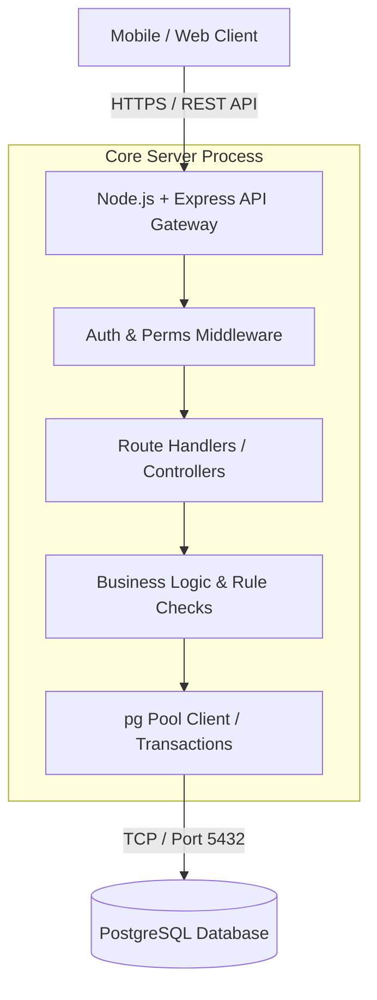
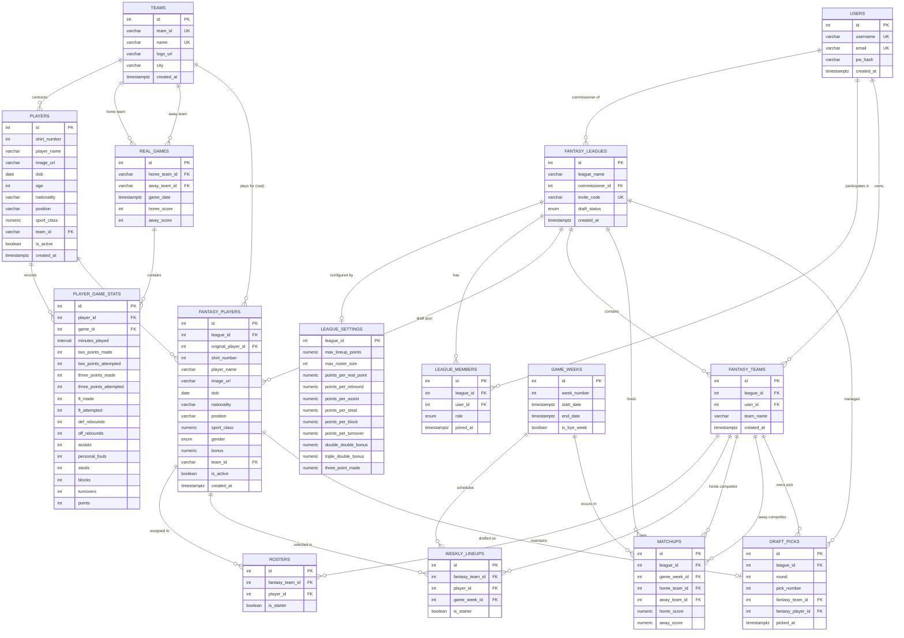

# Backend System Architecture & Design

This document describes the architectural layout, technology stack, data flows, and design decisions for the backend API service.

---

## System Overview

The backend acts as a stateless RESTful API service providing business logic, authentication, data validation, and persistence for fantasy sport management.

## Data Model & Entity Relationships

# TODO
## REST API Endpoint Specifications

All API endpoints are prefixed with `/api`. Authentication is handled via Bearer Tokens in the `Authorization` header.

### 1. Authentication & Users

| Endpoint | Method | Auth | Description | Payload / Query Parameters |
| :--- | :--- | :--- | :--- | :--- |
| `/auth/register` | `POST` | Public | Register a new user account | **Body:** `{ username, email, password }` |
| `/auth/login` | `POST` | Public | Authenticate user and issue JWT | **Body:** `{ email, password }` |
| `/users/me` | `GET` | Bearer | Get current user's profile | None |

### 2. Leagues & Membership

| Endpoint | Method | Auth | Description | Payload / Query Parameters |
| :--- | :--- | :--- | :--- | :--- |
| `/leagues` | `GET` | Bearer | List leagues joined or created by user | `?role=commissioner` |
| `/leagues` | `POST` | Bearer | Create a new fantasy league | **Body:** `{ league_name, max_roster_size, max_lineup_points }` |
| `/leagues/join` | `POST` | Bearer | Join a league via invite code | **Body:** `{ invite_code }` |
| `/leagues/:id/members` | `GET` | Bearer | Fetch members of a specific league | None |

### 3. Fantasy Teams & Rosters

| Endpoint | Method | Auth | Description | Payload / Query Parameters |
| :--- | :--- | :--- | :--- | :--- |
| `/leagues/:id/teams` | `POST` | Bearer | Claim/create a team in a league | **Body:** `{ team_name }` |
| `/teams/:team_id/roster` | `GET` | Bearer | View full player roster for a team | None |
| `/teams/:team_id/roster` | `POST` | Bearer | Add player to team roster (Free Agent) | **Body:** `{ fantasy_player_id }` |
| `/teams/:team_id/roster/:player_id` | `DELETE` | Bearer | Drop player from team roster | None |

### 4. Lineups & Matchups

| Endpoint | Method | Auth | Description | Payload / Query Parameters |
| :--- | :--- | :--- | :--- | :--- |
| `/teams/:team_id/lineup` | `GET` | Bearer | Retrieve team lineup for a game week | `?game_week_id=1` |
| `/teams/:team_id/lineup` | `PUT` | Bearer | Submit/update weekly starting lineup | **Body:** `{ game_week_id, player_ids: [] }` |
| `/leagues/:id/matchups` | `GET` | Bearer | View head-to-head matchups for a week | `?game_week_id=1` |

### 5. Draft Management

| Endpoint | Method | Auth | Description | Payload / Query Parameters |
| :--- | :--- | :--- | :--- | :--- |
| `/leagues/:id/draft` | `GET` | Bearer | Fetch draft status and pick order | None |
| `/leagues/:id/draft/pick` | `POST` | Bearer | Submit a draft pick during a live draft | **Body:** `{ fantasy_player_id, round, pick_number }` |
